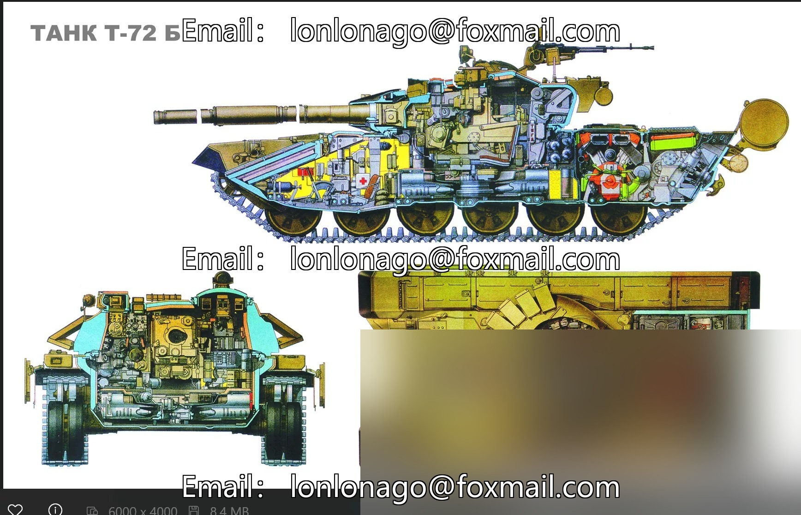
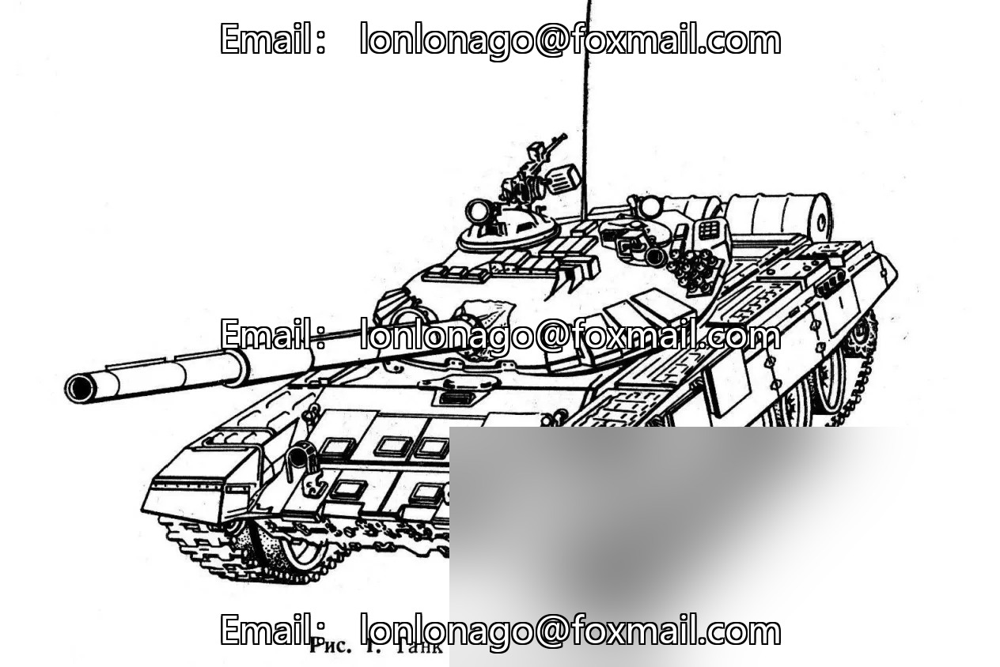
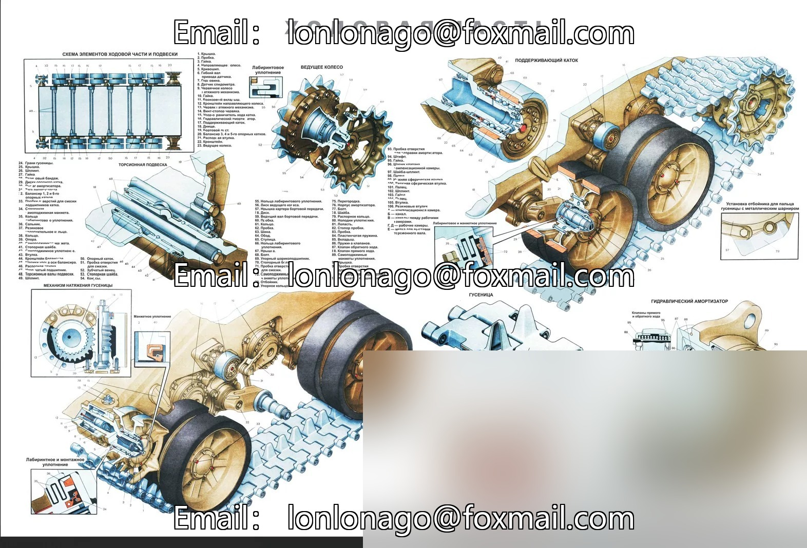
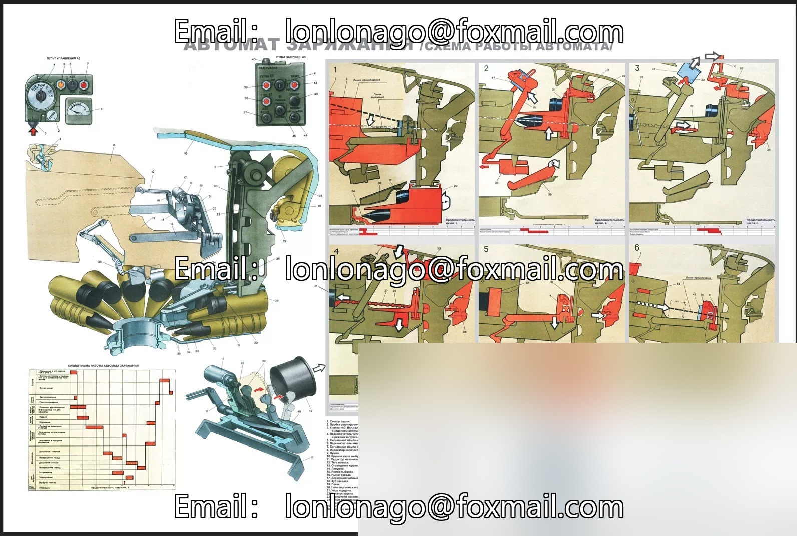
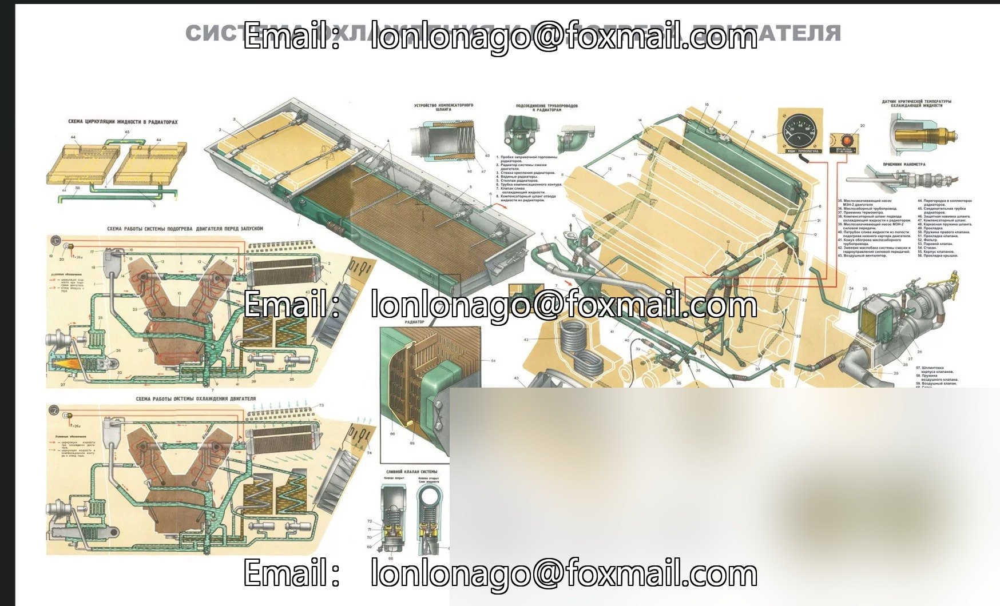
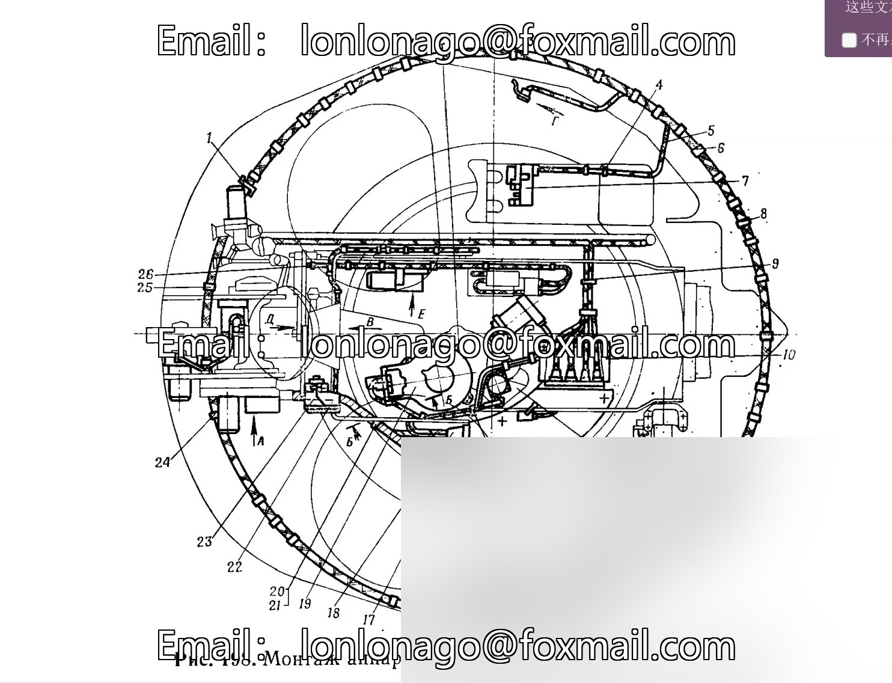
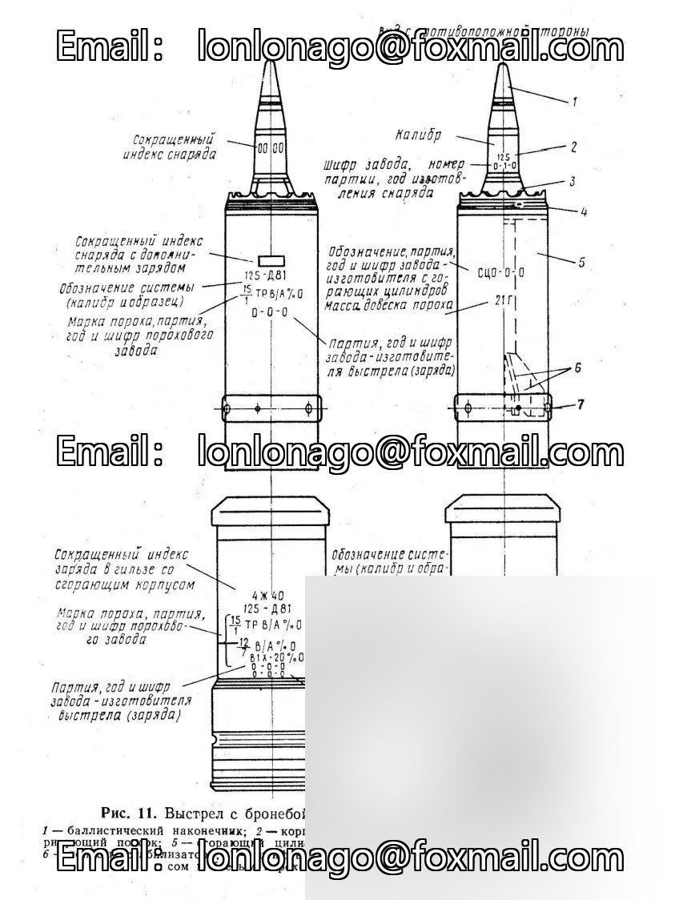
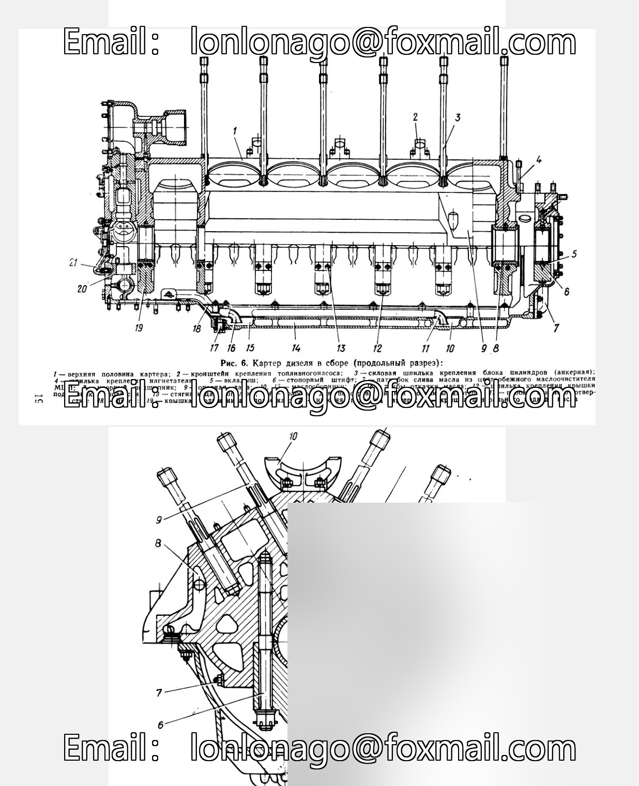
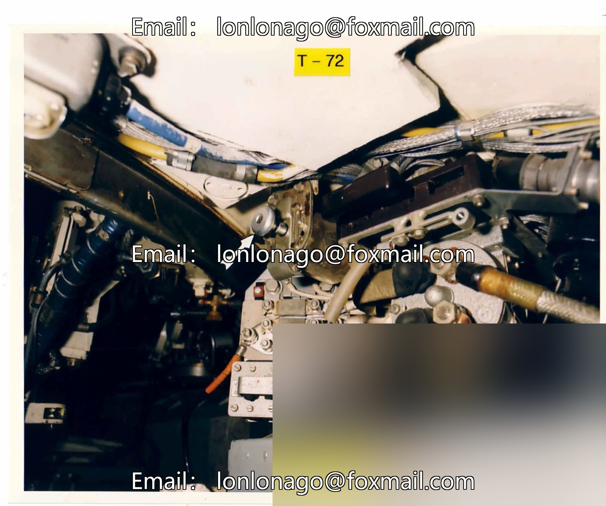

# Update — Full set of 23 volumes of technical documentation for the main battle tank T-72 of the Soviet/USSR.

## Body

[Fire] Update—The complete technical documentation of the main fighting tank T-72 for the Soviet/Chinese. 23 volumes.
The time span ranges from 1975 to 2016, covering the technical evolution of nearly half a century for the tank family.

Summary as follows:

Complete technical lineage, clear iteration: the materials are complete and clearly outline the core technical development thread of the T-72 tank.

The main cannon system: from the 2A26 used in the early T-72, to the main model's 2A46/2A46-1, and then the modern improved version's 2A46M/2A46M-1, providing a complete set of documents from drawings, technical specifications, to shooting guides.

Vehicle evolution: it includes technical descriptions and operation manuals for the basic type "Uralla" (project code), large-scale production T-72A, and major improvement type T-72B (including the 1989 model). The maintenance guide for the export type T-72M1 is also included.

Power system: It includes materials from the early V-46-6 engine part catalog to late V-84M diesel engine technical descriptions, reflecting the upgrade of the power unit.

Document types are complete, with clearly defined value levels: This collection not only includes practical manuals for the military, but also deep engineering design materials.

Design and production grade: such as the "drawing sets" for each type of fire cannon, "Catalogue of parts and assembled parts" And the circuit diagram collection of the stabilizer. It is the cornerstone of understanding its design principles and conducting in-depth technical analysis.

Military operations and maintenance level: *Operation Manual*, *Military Maintenance Manual*, *Technical Use and Shooting Guide*, etc., which detail operational procedures, daily maintenance, and battlefield maintenance for equipment, being key for studying its actual deployment and logistics support.

Comprehensive technical description level: The 《technical descriptions》 for each model provide complete performance parameters, system composition, and principle overview, which are the core reference materials for comprehensive research.

Teaching and display materials: Posters for "Overall Structure and Maintenance," which are auxiliary materials for intuitively understanding the tank layout.

Focusing on key technical subsystems: The materials specifically strengthen the decomposition of core subsystems.

Fire cannon control system: Technical description and circuit diagram collection regarding the 28M weapon stabilizer; it provides rare first-hand materials to understand its fundamental stabilization capability of the fire control system.

Propulsion and transmission: specialized documents pertain to the transmission mechanism, chassis, and engine, constituting a complete technical annotation of its maneuverability.
2A46M Type 125mm tank gun (2016)

125mm tank cannon 2A26 and 2A26M2 type drawings collection (1974)

125mm tank cannon 2A46 and 2A46-1 type technical usage and shooting guide (1979)

125mm tank gun 2A46 and 2A46-1 model technical usage and shooting guide (drawing set (1988))

125 mm tank cannon 2A46M and 2A46M-1 models (1984)

T-72M1 tank maintenance guide

T-72 tank (Weapons and Armament, 1979)

V-46-6 Engine Part Catalog (1986)

V-84M diesel engine technical description (1991)

T-72 tank overall structure and maintenance poster - JPG format

T-72 tank 2E28M-type stabilizer circuit diagram collection (1979)

T-72 tank 2-E28M stabilizer technical description (1979)

T-72B tank technical description (2002)

T-72 tank parts and assembly items catalog (1980)

T-72a tank technical description and operation manual volume 1 (1986)

T-72A tank technical instructions and operation manual, Volume 2, Part 1 (1989)

T-72A Tank Technical Description and Operation Manual Volume 2, Part 2 (1989)

T-72B tank operation manual

T-72B tank (1989 model) technical instructions and operation manual (1995)

"Urals" tank crew maintenance manual volume 1 part 1 (1976)

"Ural" tank technical description (1975)

T-72B tank (2011)

This is an update to the complete technical documentation set for the Sino-Russian T-72 main battle tank, covering technology evolution from 1975 to 2016 across multiple categories including main guns, vehicle models, power systems, design and production, as well as unit operations and maintenance.

<!-- AI_ENRICHED -->

## Images

## Payment

Here is a pay link on Stripe ( https://buy.stripe.com/3cs8yP7sY87d0vu9AB ). Please contact me lonlonago@foxmail.com after funding $89, and I will send you a complete data files , thank you!

